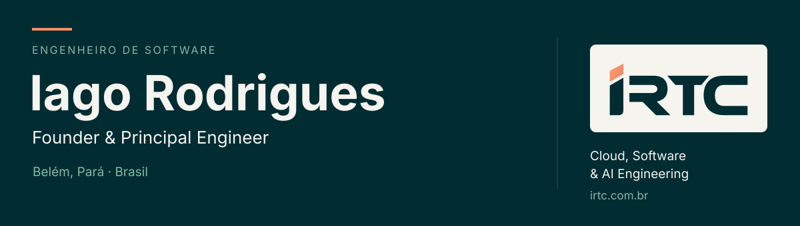

<picture>
  <source media="(max-width: 600px)" srcset="./assets/profile-header-mobile.svg">
  
</picture>

[English](README.md) · [Português](README.pt-BR.md)

[IRTC](https://irtc.com.br/en) · [LinkedIn](https://www.linkedin.com/in/iago-rodrigues/) · [Writing](#writing) · [Contact](#contact)

## About me

I'm Iago, Founder & Principal Engineer at [IRTC](https://irtc.com.br/en), based in Belém, Brazil. I work with business and technology teams on systems integration, process automation, and software modernization.

My initial focus at IRTC is a practical problem: information that has to be re-entered between sales, finance, and operations systems. We start with one workflow, identify exceptions and dependencies, and define a scope and acceptance criteria before proposing implementation.

I have eight years of experience building web applications, a background as a Senior Frontend Engineer, and a degree in Information Systems. My professional experience includes individual contractor engagements. I attribute that work to my own role and the relevant engagement; IRTC projects have their own scope, delivery records, and client authorization.

## Engineering at IRTC

IRTC is a B2B engineering partner working across Cloud, Software & AI Engineering:

| Area | Decisions and work |
|---|---|
| Cloud Engineering | Assess AWS architecture, operating costs, and modernization priorities. |
| Software Engineering | Connect systems, automate a defined process, and modernize software in manageable stages. |
| AI Engineering | Evaluate AI for a specific task, including output quality, cost, permissions, and human review. |

For an initial integration, we discuss one workflow between up to two systems. The proposal defines deliverables, dependencies, tests, documentation, and acceptance criteria. Scope and availability depend on the problem and confirmed delivery capacity.

**[Tell us which process needs to work better](https://irtc.com.br/en/contact).**

## Technologies

I work with TypeScript, Node.js, and PostgreSQL, alongside JavaScript, Vue, and React for web applications. My work includes architecture, accessibility, implementation, and software maintenance.

`TypeScript` `Node.js` `PostgreSQL` `JavaScript` `Vue` `React` `Tailwind CSS`

I also use NestJS, Django, GraphQL, MySQL, and MongoDB. For delivery and testing: Git, GitHub Actions, Docker, and Jest. I'm deepening my skills in AWS, software modernization, AI integrations, and agentic workflows.

## Projects and attribution

This profile contains my personal repositories and contributions. Company repositories live in [IrtcAI](https://github.com/IrtcAI). A demonstration or learning project is identified by its purpose and limitations; client results are published only with supporting evidence and permission.

## Writing

I write about software development on [DEV Community](https://dev.to/oiagorodrigues) and [Medium](https://medium.com/@iagokv).

## Outside work

I enjoy video games, watching movies and TV with my family, and spending time with my two cats, Juliette and Luna.

## Contact

For IRTC projects and partnerships, [describe the process or system you want to improve](https://irtc.com.br/en/contact).

For conversations about my individual engineering experience, find me on [LinkedIn](https://www.linkedin.com/in/iago-rodrigues/).
